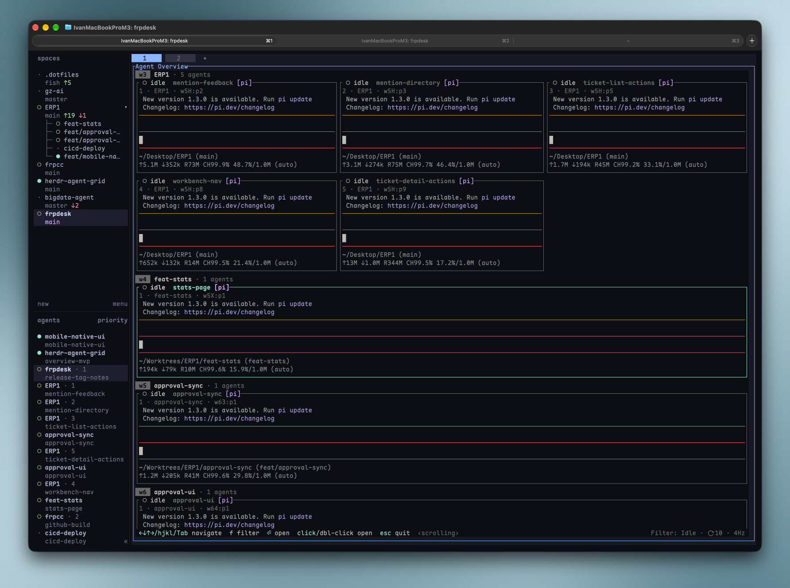

# herdr-plugin-agent-overview



A full-screen, read-only **agent overview for [Herdr](https://herdr.dev)**:
one live ANSI tile per agent pane, grouped by workspace, with a one-keystroke
jump back to the real pane. By default it shows only **working agents** —
press `f` to cycle the filter `Working → Done → Idle`.

Built in Rust with ratatui, derived from
[vjeantet/herdr-mission-control](https://github.com/vjeantet/herdr-mission-control)
(MIT). Thanks to the upstream author.

## Features

- **Live tiles** — every visible agent pane becomes a card showing its real
  terminal viewport (`pane.read`, source `visible`, format `ansi`) refreshed at
  ~4 Hz, with ANSI colors/styles and Unicode preserved and cropped to the
  latest output. Source panes are never resized, scrolled or written to.
- **Status filter** — only the selected official state is shown and read:
  `Working` (default), `Done`, `Idle`; `blocked` / `unknown` are not shown in
  this version. Cards appear and disappear automatically as agent state
  changes. An empty filter shows `No working agents` / `No done agents` /
  `No idle agents`.
- **Keyboard + mouse** — grid navigation, `Tab` cycling, `Enter` /
  double-click to focus the original pane and close the overview, wheel
  scrolling (mouse requires your terminal to forward mouse reports to the
  popup).
- **Safe toggle** — invoking the action twice closes only this plugin's own
  popup (pid + socket fingerprint), never someone else's popup.
- **Resilient** — a disconnected socket keeps the last data with a banner and
  reconnects automatically; a single unreadable pane never blocks the others.

## Install

```bash
git clone https://github.com/ivanusong/herdr-plugin-agent-overview.git
cd herdr-plugin-agent-overview
sh scripts/build.sh            # cargo build --release
herdr plugin link "$(pwd)"
```

Or install directly from GitHub:

```bash
herdr plugin install ivanusong/herdr-plugin-agent-overview
```

Requirements: Herdr ≥ 0.9.4, a Rust toolchain (`rustup`), macOS or Linux.

## Keybinding

Add to `~/.config/herdr/config.toml`:

```toml
[[keys.command]]
key = "prefix+o"
type = "plugin_action"
command = "ivan.agent-overview.open"
description = "toggle agent overview"
```

Or invoke it directly:

```bash
herdr plugin action invoke ivan.agent-overview.open
```

## Keys

| Key | Action |
| --- | --- |
| `f` | cycle status filter: `Working → Done → Idle` (shown in the footer) |
| `←↓↑→` / `h j k l` | move selection across the grid |
| `Tab` / `Shift+Tab` | cycle through all cards |
| `Enter` / double-click | focus the original pane and close the overview |
| single click | select a card |
| wheel | scroll the grid |
| `Esc` / `q` | close the overview |

## License

MIT — see [LICENSE](LICENSE), which includes the upstream
herdr-mission-control copyright notice.

---

中文说明：[docs/README.zh-CN.md](docs/README.zh-CN.md)
